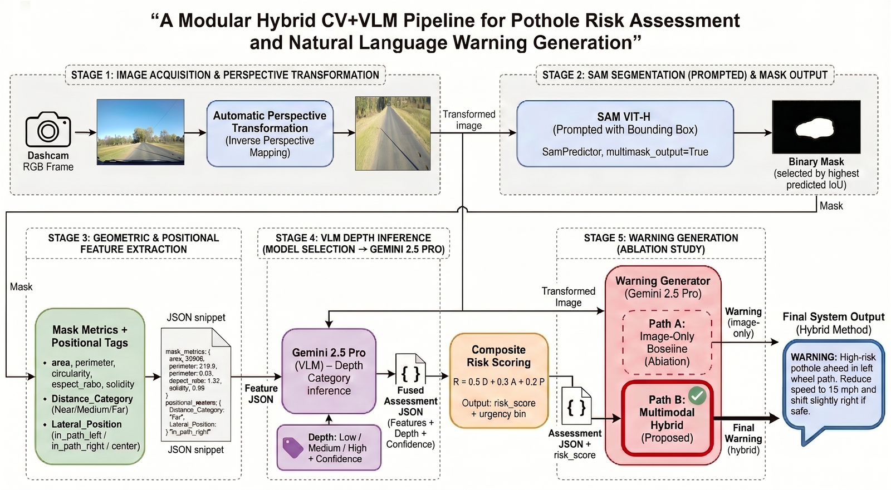

# Pothole Risk Assessment with Geometrically Grounded Vision Language Models

Code, data and analyses for the paper by Abdalmalek Aburaddaha, Zaid A. El Shair,
Ali Al-Bustami and Samir A. Rawashdeh (Department of Electrical and Computer
Engineering, University of Michigan–Dearborn), under review at *IEEE Access*.

The framework is an offline, five-stage pipeline that assesses already-detected
potholes in dashcam images:

1. **Perspective transformation** of the dashcam frame (one fixed homography)
2. **Zero-shot segmentation** with SAM ViT-H, prompted with each pothole box
3. **Geometric features**: area, perimeter, circularity, aspect ratio, solidity, and position
4. **Severity classification and risk scoring**: Gemini 2.5 Pro assigns a perceived severity class, combined with area and position into a composite risk score
5. **Warning generation**: Gemini 2.5 Pro writes a driver advisory from the image and the structured assessment



## Main results

| Finding | Result |
|---|---|
| Blind preference for grounded warnings (3 raters × 50 scenes) | 3.5 : 1; clarity +0.83 and safety +0.73 on a five-point scale |
| Urgency shift relative to image-only warnings (1,119 scenes) | 26.7 % of scenes moved out of the high tier; critical-tier assignments up 109 % (Stuart–Maxwell p < 10⁻¹⁵) |
| Six-arm prompt ablation (Gemini 2.5 Pro, 300 scenes) | the rubric alone adds 2 points of rubric consistency; the per-pothole measurements bring it to 99 % |
| Segmentation against human-drawn masks | mean IoU 0.780 |
| Severity agreement with a prediction-free human panel | κ = 0.139, against κ = 0.605 among the annotators |
| Severity agreement with physically measured depth | κ = 0.098; the predicted classes preserve the depth ordering |

The severity classes are perceived visual categories, not depth measurements. The
generated maneuvers are advisory research outputs, not validated vehicle guidance.

## Repository layout

```
paper1_pipeline/
├── main.py                    Stages 1-3: SAM segmentation and geometric features
├── detection/                 perspective transformation, crops, distance/lateral bands
├── vlm/                       Stages 4-5: Gemini clients, risk scoring, warning generation,
│                              the published prompts, and the original analyses
└── revision_analyses/         every analysis added in the revision, with its results
data/
├── sample/                    30 scenes with boxes and Stage 4 labels (runs out of the box)
├── enpad/                     complete pipeline outputs for all scenes (no images)
└── human_studies/             anonymized human annotations and ratings
docs/figures/                  figures used in this README
scripts/download_models.sh     SAM ViT-H weights
repo_config.py                 path resolution (set POTHOLE_DATA_ROOT for the full corpus)
```

## Installation

```bash
pip install -r requirements.txt
bash scripts/download_models.sh            # SAM ViT-H
echo "GOOGLE_API_KEY=..." > paper1_pipeline/vlm/.env   # needed for Stages 4-5 only
```

## Reproducing the reported tables

These two scripts run from the released data alone, with no API key or GPU:

```bash
python paper1_pipeline/revision_analyses/panel_analysis.py     # Tables 6, 7, 8, 16
python paper1_pipeline/revision_analyses/warning_analysis.py   # Tables 9-13
```

The other revision analyses (validation against measured depth, the prompt ablation,
segmentation IoU, run-to-run variability) are listed with their inputs and results in
[`paper1_pipeline/revision_analyses/README.md`](paper1_pipeline/revision_analyses/README.md).

## Running the pipeline

```bash
python paper1_pipeline/main.py               # Stages 1-3 on the bundled sample
python paper1_pipeline/vlm/Run_Pipeline.py   # Stages 4-5 (Gemini API)
```

The full 1,119-scene run took 8.2 h of wall-clock time and cost about $117.50 in API
fees ($0.105 per scene). The complete outputs are in `data/enpad/`, so no analysis
needs a re-run: hosted models are not guaranteed to reproduce their earlier outputs.

## Data

See [`data/README.md`](data/README.md). The images come from the public dataset of
Nienaber, Booysen and Kroon (2015) and remain subject to its terms.

## License

Code is released under the MIT License (`LICENSE`). Annotations, pipeline outputs and
human-study data are released under CC BY 4.0 (`DATA_LICENSE.md`).

## Citation

```bibtex
@article{aburaddaha_pothole_vlm,
  author  = {Aburaddaha, Abdalmalek and El Shair, Zaid A. and Al-Bustami, Ali and Rawashdeh, Samir A.},
  title   = {Pothole Risk Assessment with Geometrically Grounded Vision Language Models},
  journal = {IEEE Access},
  note    = {under review},
  year    = {2026}
}
```

## Contact

Abdalmalek Aburaddaha, abdmalek@umich.edu
