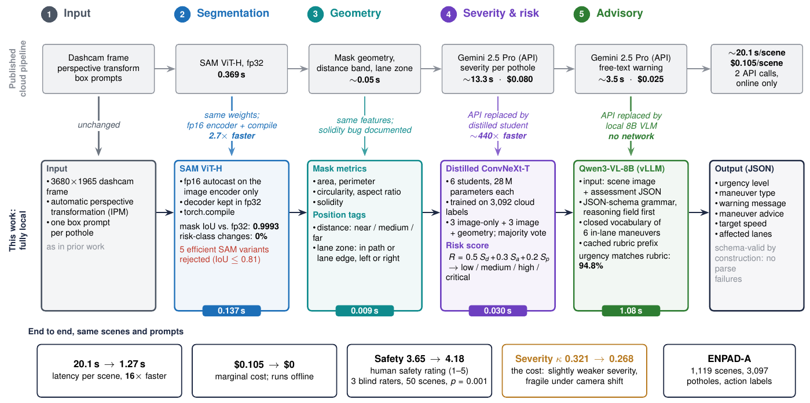
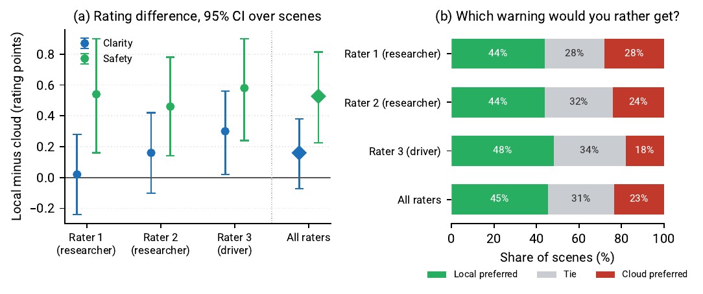

# Paper 2: fully local pipeline

Code for *From Cloud to Edge: A Fully Local Pipeline for Pothole Risk Assessment and
Driver Warning Generation* (A. Aburaddaha and S. A. Rawashdeh, submitted to *Sensors*).
It rebuilds every stage of the Paper 1 pipeline (`../paper1_pipeline/`) to run on one
local GPU, and evaluates it with the same data, prompts and protocol.



| Stage | Cloud pipeline (Paper 1) | Local pipeline (this folder) |
|---|---|---|
| 2 Segmentation | SAM ViT-H, fp32 | the same ViT-H weights, fp16 image encoder + `torch.compile`: 2.7× faster, IoU 0.9993 against fp32, no risk-class change |
| 4 Severity | Gemini 2.5 Pro (κ 0.321 against the human panel) | six ConvNeXt-Tiny students distilled from 3,092 cloud labels: κ 0.268 at 28 ms per pothole |
| 5 Warning | Gemini 2.5 Pro | Qwen3-VL-8B served with vLLM, decoded under a grammar with only in-lane maneuvers |
| End to end | about 20 s and $0.105 per scene | 1.27 s per scene, offline, no per-scene fee |

Five lightweight SAM variants (MobileSAM, TinySAM, EfficientViT-SAM-L2/XL1, SAM 2.1-small)
were faster but failed mask-fidelity criteria fixed before they were measured, so Stage 2
keeps the original weights.

## Main results

| Finding | Result |
|---|---|
| Blind human ratings, local vs cloud warnings (3 raters × 50 scenes) | safety 4.18 vs 3.65 of 5 (Wilcoxon p = 0.001); clarity equal |
| Lane-departure advice over 1,119 scenes | 48.4 % for the unconstrained local generator, 6.1 % with the in-lane grammar, 0.4 % for the cloud system |
| Urgency of the constrained local warnings vs the reference | 94.8 % agreement (95 % CI 93.5–96.1) |
| Automated LLM judge vs the humans | ranks the systems the other way: 1.21 points below the humans on local safety, 0.55 above on cloud safety |
| Distilled severity grader under a camera-geometry shift | fails; strong scale and crop augmentation did not fix it (κ −0.059) |



The automated judge is not a safety oracle. Use it for prose quality at most, never in
place of a human safety evaluation.

## Layout

| Path | Role |
|---|---|
| `pipeline/paper2_pipeline.py` | the end-to-end local pipeline, Stages 1–4 (runs on the bundled sample) |
| `pipeline/package_enpad_a.py`, `pipeline/merge_final_labels.py` | corpus packaging and label consolidation |
| `benchmarks/bench_stage2_baseline.py` | SAM ViT-H fp32 reference |
| `benchmarks/bench_stage2_vith_optimized.py` | fp16 encoder and `torch.compile` |
| `benchmarks/bench_stage2_candidates.py`, `bench_stage2_windowed.py` | the five lightweight SAM variants, full-frame and tiled |
| `benchmarks/eval_distilled_vs_metric.py` | severity against measured depth (PothRGBD) |
| `benchmarks/ensemble_variance.py` | spread of the distilled ensemble across training runs |
| `benchmarks/measure_advisory_safety.py` | lane-departure rate and McNemar test |
| `benchmarks/analyze_human_round2.py` | the reported human study (scene-level tests) |
| `benchmarks/llm_judge_warnings.py` | automated judge (see the caution above) |
| `benchmarks/paper2_statistics.py`, `audit_paper2_numbers.py` | statistics and a check of the numbers quoted in the paper |
| `stage4_5_local_vlm/train_depth_distilled.py` | ConvNeXt student training |
| `stage4_5_local_vlm/eval_depth_local.py` | open-weight VLM severity baselines (vLLM) |
| `stage4_5_local_vlm/generate_warnings_local.py` | grammar-constrained warning generation (vLLM) |
| `common/build_human_eval_set.py`, `common/build_eval_kit.py` | blinded human-evaluation kits |
| `figures/make_result_figures.py`, `make_pipeline_figure.py` | the paper's figures, from results files |

## Environments

The local VLM stack pins a different PyTorch than the segmentation and distillation
stack, so two environments are needed (versions in `../requirements.txt`):

```bash
# paper2: Stages 1-4, distillation, Stage-2 benchmarks
conda create -n paper2 python=3.11 -y && conda activate paper2
pip install torch==2.7.1 torchvision==0.22.1 --index-url https://download.pytorch.org/whl/cu126
pip install -r requirements.txt

# vllm: Stage 5 and the VLM severity baselines
conda create -n vllm python=3.12 -y && conda activate vllm
pip install torch==2.8.0 --index-url https://download.pytorch.org/whl/cu128
pip install vllm==0.11.0 transformers==4.57.1 peft==0.20.0 qwen-vl-utils
```

The serving stack is pinned because the outputs proved sensitive to version changes.

## Running

From the repository root, on the bundled 30-scene sample:

```bash
conda activate paper2
bash scripts/download_models.sh            # SAM ViT-H and the six severity models into checkpoints/
python paper2_pipeline/pipeline/paper2_pipeline.py --limit 30 --out results/sample_assessments.json
```

The six distilled severity models (`distill_convnext_tiny_{image,twotower}_s{42,43,44}.pt`,
112 MB each, too large for git) are attached to the
[v2.0-paper2 release](https://github.com/malekaburaddaha/Pothole_Assessment_Pipeline/releases/tag/v2.0-paper2); the download script fetches them into
`checkpoints/distilled_severity/` and checks them against the release's `SHA256SUMS`.
They can also be retrained with `stage4_5_local_vlm/train_depth_distilled.py` on the full
corpus.

The first scenes pay the `torch.compile` warm-up, so the per-scene time on a short run
is well above the 1.27 s measured over the full corpus.

The training, benchmark and evaluation scripts were run inside the full research tree
(the full corpus, cached cloud outputs, image patches, PothRGBD and the human-study
kits). They read it from `$POTHOLE_ROOT` (default: the current directory), laid out as
in each script's path constants. That material is not in git; see `../data/README.md`
and the paper's Data Availability statement.

## Determinism

Distillation is deterministic on purpose: seeded RNGs and dataloader workers,
`cudnn.deterministic`, `torch.use_deterministic_algorithms` and
`CUBLAS_WORKSPACE_CONFIG`. Before this, two runs with the same seed gave κ 0.129 and
0.333 for one model.
